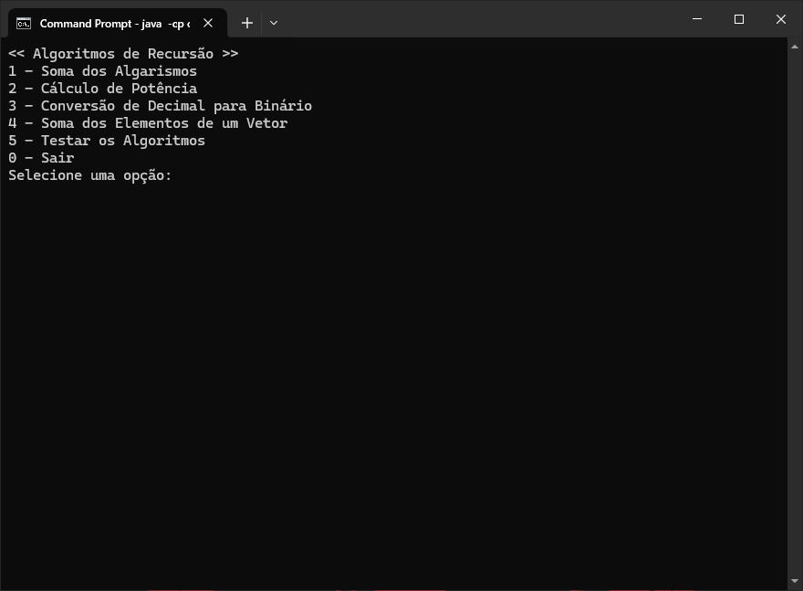
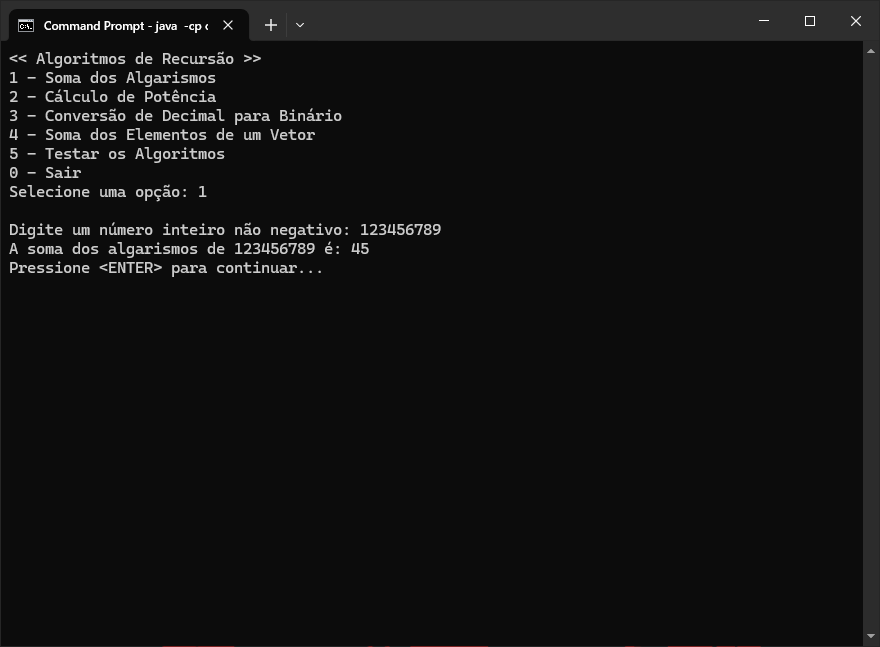
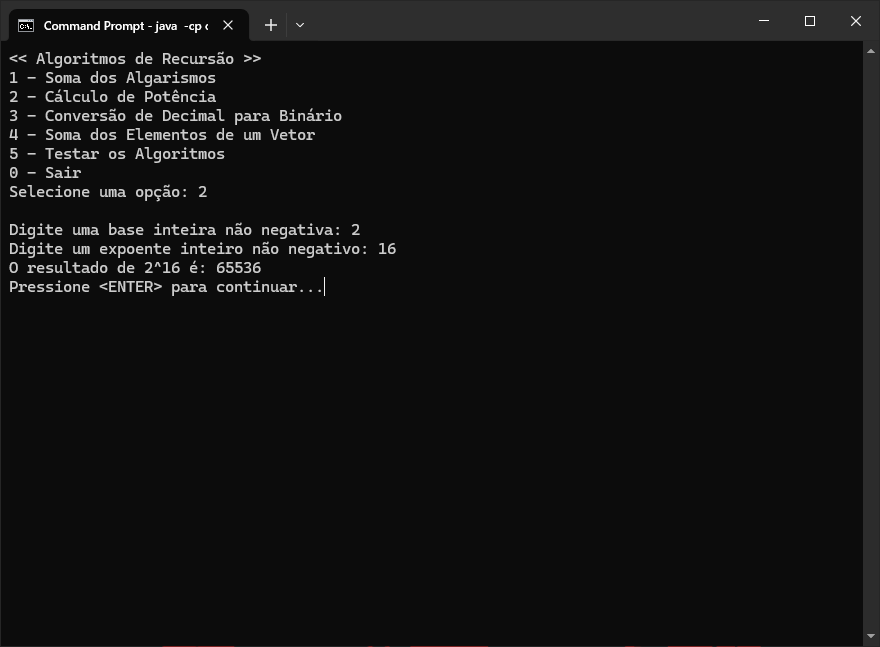
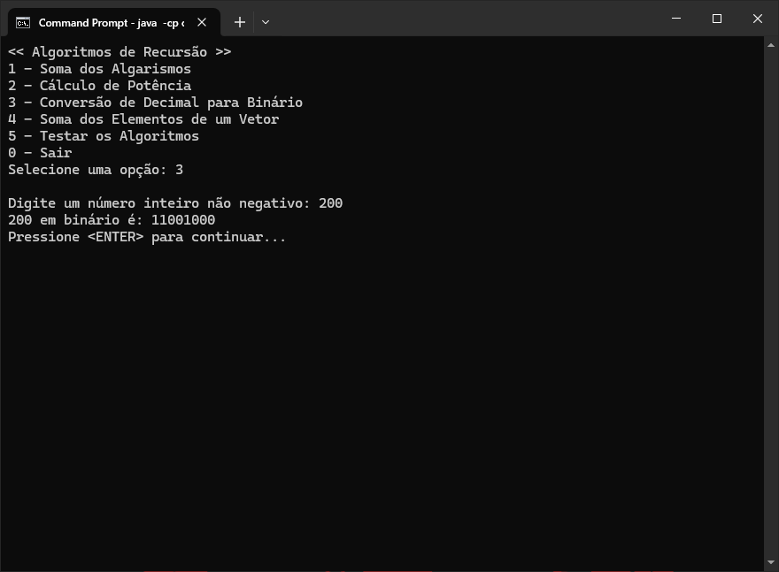
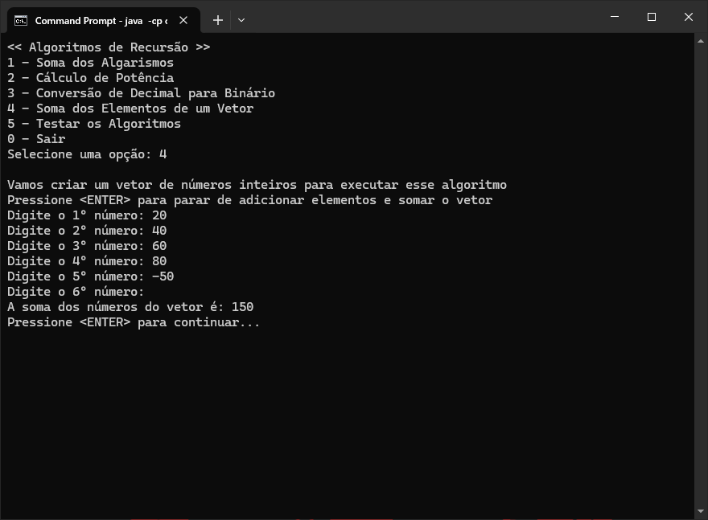
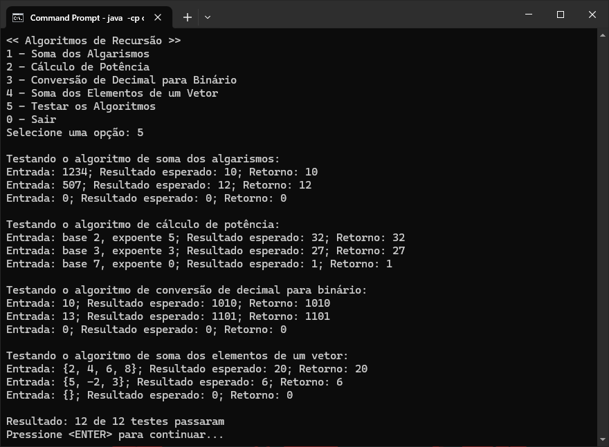

# Algoritmos de Recursão em Java

Projeto desenvolvido em Java 26 com o objetivo de estudar e aplicar conceitos de **recursividade**, implementando algoritmos clássicos por meio de chamadas recursivas.

A aplicação funciona pelo terminal e disponibiliza um menu interativo para executar os algoritmos individualmente ou testar seus resultados.

## Funcionalidades

O programa implementa quatro algoritmos recursivos:

1. **Soma dos Algarismos:** recebe um número inteiro e calcula a soma de seus algarismos.
2. **Cálculo de Potência:** calcula a potência de uma base elevada a um expoente inteiro não negativo.
3. **Conversão de Decimal para Binário:** converte um número decimal inteiro não negativo para sua representação binária.
4. **Soma dos Elementos de um Vetor:** percorre uma lista ligada recursivamente para calcular a soma de seus elementos.

Além disso, o programa possui uma funcionalidade de testes que executa diferentes casos para verificar os resultados dos algoritmos em relação aos valores esperados.

## Tecnologias utilizadas

- Java 26
- IntelliJ IDEA
- Git e GitHub

## Screenshots

### Menu principal



### Soma dos algarismos



### Cálculo de potência



### Conversão de decimal para binário



### Soma dos elementos de um vetor



### Testes dos algoritmos



## Estrutura do projeto

```text
algoritmos-recursao/
├── src/                    # Códigos-fonte Java
├── out/                    # Arquivos compilados (.class)
├── docs/
│   └── images/             # Screenshots do projeto
├── .github/
│   └── workflows/
│       └── build.yml       # Automação de compilação
├── .gitignore
└── README.md
```

O diretório `out/` é utilizado para armazenar os arquivos compilados e não é versionado no Git.

## Pré-requisitos

Antes de executar o projeto, certifique-se de possuir:

- [JDK 26](https://www.oracle.com/java/technologies/downloads/)
- [Git](https://git-scm.com/downloads)

Para verificar a instalação do Java:

```bash
java -version
javac -version
```

Ambos devem indicar a versão 26.

## Como clonar o repositório

Abra o terminal e execute:

```bash
git clone https://github.com/cdGuilherme/algoritmos-recursao.git
```

Entre no diretório do projeto:

```bash
cd algoritmos-recursao
```

## Compilação

Crie o diretório de saída:

```bash
mkdir out
```

Compile os arquivos Java:

```bash
javac -d out src/*.java
```

A opção `-d out` determina que os arquivos `.class` sejam gerados no diretório `out/`, mantendo os códigos-fonte organizados em `src/`.

## Execução

Após a compilação, execute:

```bash
java -cp out Main
```

O programa apresentará um menu interativo no terminal, permitindo selecionar os algoritmos disponíveis.

## Testes

A opção **5 - Testar os Algoritmos** executa casos de teste predefinidos para verificar o funcionamento das implementações.

Os resultados são comparados com os valores esperados, indicando quais testes passaram ou falharam.

## Integração contínua (GitHub Actions)

O projeto utiliza GitHub Actions para automatizar o processo de compilação.

O workflow é executado automaticamente em atualizações nas branches principais e em pull requests, utilizando Java 26.

Após uma compilação bem-sucedida, um arquivo JAR é gerado e disponibilizado como artefato para download na execução do workflow.